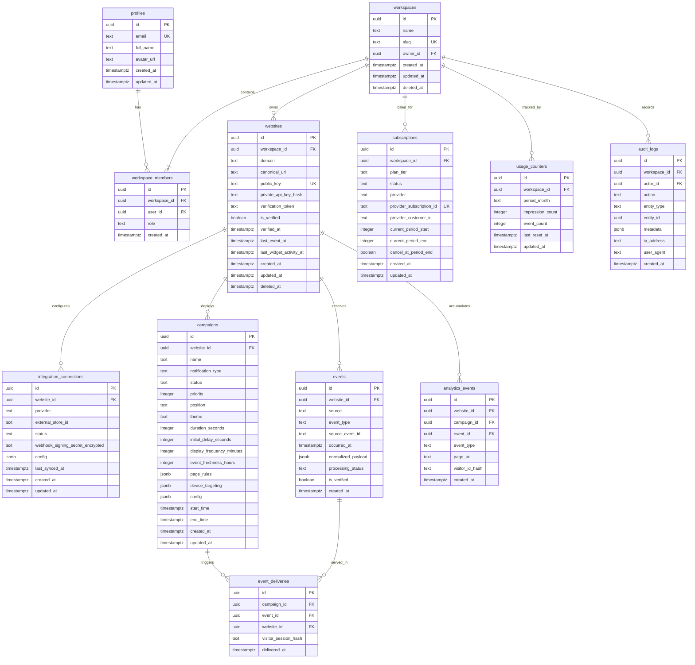

# ProofPulse Database Design & Schema Specification

## 1. Schema Overview

The ProofPulse data tier is hosted on **PostgreSQL 15+** (leveraging Supabase managed PostgreSQL). It enforces strict relational integrity, foreign key cascades, tenant isolation through `workspace_id`, and optimized composite indexes for high-throughput event ingestion and time-series analytics queries.

---

## 2. Entity Relationship Diagram (ERD)



---

## 3. Detailed Table Specifications

### 3.1. `profiles`
Maps 1:1 with Supabase `auth.users`.
- `id` (UUID, PK, References `auth.users(id)` ON DELETE CASCADE)
- `email` (TEXT, NOT NULL, UNIQUE)
- `full_name` (TEXT)
- `avatar_url` (TEXT)
- `created_at` (TIMESTAMPTZ, DEFAULT NOW())
- `updated_at` (TIMESTAMPTZ, DEFAULT NOW())

### 3.2. `workspaces`
Multi-tenant isolation root.
- `id` (UUID, PK, DEFAULT gen_random_uuid())
- `name` (TEXT, NOT NULL)
- `slug` (TEXT, NOT NULL, UNIQUE)
- `owner_id` (UUID, NOT NULL, References `profiles(id)`)
- `created_at` (TIMESTAMPTZ, DEFAULT NOW())
- `updated_at` (TIMESTAMPTZ, DEFAULT NOW())
- `deleted_at` (TIMESTAMPTZ, NULLABLE - soft delete)

### 3.3. `workspace_members`
Role-Based Access Control (RBAC) membership.
- `id` (UUID, PK, DEFAULT gen_random_uuid())
- `workspace_id` (UUID, NOT NULL, References `workspaces(id)` ON DELETE CASCADE)
- `user_id` (UUID, NOT NULL, References `profiles(id)` ON DELETE CASCADE)
- `role` (TEXT, NOT NULL, CHECK (role IN ('owner', 'admin', 'member', 'viewer')))
- `created_at` (TIMESTAMPTZ, DEFAULT NOW())
- **Constraint**: UNIQUE (`workspace_id`, `user_id`)

### 3.4. `websites`
Merchant digital property registered for widget deployment.
- `id` (UUID, PK, DEFAULT gen_random_uuid())
- `workspace_id` (UUID, NOT NULL, References `workspaces(id)` ON DELETE CASCADE)
- `domain` (TEXT, NOT NULL, e.g., "mystore.in")
- `canonical_url` (TEXT, NOT NULL, e.g., "https://mystore.in")
- `public_key` (TEXT, NOT NULL, UNIQUE, e.g., "pp_pub_live_...")
- `private_api_key_hash` (TEXT, NOT NULL - Argon2id / SHA256 hashed secret for server ingestion)
- `verification_token` (TEXT, NOT NULL, e.g., "proofpulse-verify-abc123xyz")
- `is_verified` (BOOLEAN, DEFAULT FALSE)
- `verified_at` (TIMESTAMPTZ)
- `last_event_at` (TIMESTAMPTZ)
- `last_widget_activity_at` (TIMESTAMPTZ)
- `created_at` (TIMESTAMPTZ, DEFAULT NOW())
- `updated_at` (TIMESTAMPTZ, DEFAULT NOW())
- `deleted_at` (TIMESTAMPTZ)
- **Indexes**:
  - `idx_websites_workspace_id` ON `websites(workspace_id)`
  - `idx_websites_public_key` ON `websites(public_key)` WHERE deleted_at IS NULL
  - `idx_websites_domain` ON `websites(domain)`

### 3.5. `integration_connections`
Credentials and synchronization state for third-party platforms (Shopify, WooCommerce, Custom).
- `id` (UUID, PK, DEFAULT gen_random_uuid())
- `website_id` (UUID, NOT NULL, References `websites(id)` ON DELETE CASCADE)
- `provider` (TEXT, NOT NULL, CHECK (provider IN ('shopify', 'woocommerce', 'custom_webhook', 'manual_api')))
- `external_store_id` (TEXT)
- `status` (TEXT, NOT NULL, DEFAULT 'active', CHECK (status IN ('active', 'error', 'disconnected')))
- `webhook_signing_secret_encrypted` (TEXT)
- `config` (JSONB, DEFAULT '{}'::jsonb)
- `last_synced_at` (TIMESTAMPTZ)
- `created_at` (TIMESTAMPTZ, DEFAULT NOW())
- `updated_at` (TIMESTAMPTZ, DEFAULT NOW())
- **Constraint**: UNIQUE (`website_id`, `provider`)

### 3.6. `campaigns`
Notification campaign configuration and targeting parameters.
- `id` (UUID, PK, DEFAULT gen_random_uuid())
- `website_id` (UUID, NOT NULL, References `websites(id)` ON DELETE CASCADE)
- `name` (TEXT, NOT NULL)
- `notification_type` (TEXT, NOT NULL, CHECK (notification_type IN (
    'recent_purchase',
    'recent_signup',
    'product_popularity',
    'live_visitors',
    'low_stock',
    'genuine_countdown'
  )))
- `status` (TEXT, NOT NULL, DEFAULT 'draft', CHECK (status IN ('draft', 'active', 'paused', 'archived')))
- `priority` (INTEGER, NOT NULL, DEFAULT 1)
- `position` (TEXT, NOT NULL, DEFAULT 'bottom_left', CHECK (position IN ('bottom_left', 'bottom_right', 'top_left', 'top_right')))
- `theme` (TEXT, NOT NULL, DEFAULT 'light', CHECK (theme IN ('light', 'dark', 'minimal', 'glassmorphic')))
- `duration_seconds` (INTEGER, NOT NULL, DEFAULT 6)
- `initial_delay_seconds` (INTEGER, NOT NULL, DEFAULT 3)
- `display_frequency_minutes` (INTEGER, NOT NULL, DEFAULT 5)
- `event_freshness_hours` (INTEGER, NOT NULL, DEFAULT 48)
- `page_rules` (JSONB, NOT NULL, DEFAULT '{"mode": "all", "paths": []}'::jsonb)
- `device_targeting` (JSONB, NOT NULL, DEFAULT '{"desktop": true, "mobile": true}'::jsonb)
- `config` (JSONB, NOT NULL, DEFAULT '{}'::jsonb)
- `start_time` (TIMESTAMPTZ)
- `end_time` (TIMESTAMPTZ)
- `created_at` (TIMESTAMPTZ, DEFAULT NOW())
- `updated_at` (TIMESTAMPTZ, DEFAULT NOW())
- **Indexes**:
  - `idx_campaigns_website_status` ON `campaigns(website_id, status)`

### 3.7. `events`
Raw and normalized verified customer events.
- `id` (UUID, PK, DEFAULT gen_random_uuid())
- `website_id` (UUID, NOT NULL, References `websites(id)` ON DELETE CASCADE)
- `source` (TEXT, NOT NULL, e.g., 'shopify', 'api', 'woocommerce')
- `event_type` (TEXT, NOT NULL, CHECK (event_type IN ('purchase', 'signup', 'registration', 'inventory_update')))
- `source_event_id` (TEXT, NOT NULL)
- `occurred_at` (TIMESTAMPTZ, NOT NULL)
- `normalized_payload` (JSONB, NOT NULL)
  - Schema for `purchase`: `{"first_name": "Priya", "city": "Bengaluru", "item_title": "Silk Saree", "item_image_url": "...", "product_url": "..."}`
- `processing_status` (TEXT, NOT NULL, DEFAULT 'processed', CHECK (processing_status IN ('pending', 'processed', 'filtered_stale', 'invalid')))
- `is_verified` (BOOLEAN, NOT NULL, DEFAULT TRUE)
- `created_at` (TIMESTAMPTZ, DEFAULT NOW())
- **Constraint (Idempotency)**: UNIQUE (`website_id`, `source`, `source_event_id`)
- **Indexes**:
  - `idx_events_website_freshness` ON `events(website_id, occurred_at DESC)` WHERE is_verified = TRUE

### 3.8. `event_deliveries`
Record of which notifications were queued and served to prevent repetition for a visitor session.
- `id` (UUID, PK, DEFAULT gen_random_uuid())
- `campaign_id` (UUID, NOT NULL, References `campaigns(id)` ON DELETE CASCADE)
- `event_id` (UUID, NOT NULL, References `events(id)` ON DELETE CASCADE)
- `website_id` (UUID, NOT NULL, References `websites(id)` ON DELETE CASCADE)
- `visitor_session_hash` (TEXT, NOT NULL)
- `delivered_at` (TIMESTAMPTZ, DEFAULT NOW())
- **Index**:
  - `idx_deliveries_session` ON `event_deliveries(website_id, visitor_session_hash, delivered_at DESC)`

### 3.9. `analytics_events`
High-volume telemetry events for impressions, clicks, and conversions.
- `id` (UUID, PK, DEFAULT gen_random_uuid())
- `website_id` (UUID, NOT NULL, References `websites(id)` ON DELETE CASCADE)
- `campaign_id` (UUID, References `campaigns(id)` ON DELETE SET NULL)
- `event_id` (UUID, References `events(id)` ON DELETE SET NULL)
- `event_type` (TEXT, NOT NULL, CHECK (event_type IN ('impression', 'click', 'dismissal', 'conversion')))
- `page_url` (TEXT)
- `visitor_id_hash` (TEXT, NOT NULL)
- `created_at` (TIMESTAMPTZ, DEFAULT NOW())
- **Indexes**:
  - `idx_analytics_website_date` ON `analytics_events(website_id, created_at DESC)`
  - `idx_analytics_campaign_type` ON `analytics_events(campaign_id, event_type, created_at DESC)`

### 3.10. `subscriptions`
Billing state, plan limits, and provider synchronisation.
- `id` (UUID, PK, DEFAULT gen_random_uuid())
- `workspace_id` (UUID, NOT NULL, UNIQUE, References `workspaces(id)` ON DELETE CASCADE)
- `plan_tier` (TEXT, NOT NULL, DEFAULT 'free', CHECK (plan_tier IN ('free', 'starter', 'growth', 'agency')))
- `status` (TEXT, NOT NULL, DEFAULT 'active', CHECK (status IN ('active', 'past_due', 'canceled', 'trialing')))
- `provider` (TEXT, NOT NULL, DEFAULT 'razorpay')
- `provider_subscription_id` (TEXT, UNIQUE)
- `provider_customer_id` (TEXT)
- `current_period_start` (BIGINT)
- `current_period_end` (BIGINT)
- `cancel_at_period_end` (BOOLEAN, DEFAULT FALSE)
- `created_at` (TIMESTAMPTZ, DEFAULT NOW())
- `updated_at` (TIMESTAMPTZ, DEFAULT NOW())

### 3.11. `usage_counters`
Server-side monthly usage tracking for quota enforcement.
- `id` (UUID, PK, DEFAULT gen_random_uuid())
- `workspace_id` (UUID, NOT NULL, References `workspaces(id)` ON DELETE CASCADE)
- `period_month` (TEXT, NOT NULL, e.g., '2026-10')
- `impression_count` (INTEGER, NOT NULL, DEFAULT 0)
- `event_count` (INTEGER, NOT NULL, DEFAULT 0)
- `last_reset_at` (TIMESTAMPTZ, DEFAULT NOW())
- `updated_at` (TIMESTAMPTZ, DEFAULT NOW())
- **Constraint**: UNIQUE (`workspace_id`, `period_month`)

### 3.12. `audit_logs`
Immutable compliance and security trail for sensitive merchant actions.
- `id` (UUID, PK, DEFAULT gen_random_uuid())
- `workspace_id` (UUID, NOT NULL, References `workspaces(id)` ON DELETE CASCADE)
- `actor_id` (UUID, References `profiles(id)` ON DELETE SET NULL)
- `action` (TEXT, NOT NULL, e.g., 'website.create', 'campaign.activate', 'apikey.rotate', 'billing.upgrade')
- `entity_type` (TEXT, NOT NULL)
- `entity_id` (UUID)
- `metadata` (JSONB, DEFAULT '{}'::jsonb)
- `ip_address` (TEXT)
- `user_agent` (TEXT)
- `created_at` (TIMESTAMPTZ, DEFAULT NOW())

### 3.13. `billing_webhook_receipts`
Idempotent processing ledger for payment provider webhooks.
- `id` (UUID, PK, DEFAULT gen_random_uuid())
- `provider` (TEXT, NOT NULL, e.g., 'razorpay')
- `event_id` (TEXT, NOT NULL)
- `event_type` (TEXT, NOT NULL)
- `processed_at` (TIMESTAMPTZ, DEFAULT NOW())
- **Constraint**: UNIQUE (`provider`, `event_id`)

---

## 4. Row Level Security (RLS) Strategy

PostgreSQL Row Level Security ensures tenant data cannot leak across workspaces even in direct client queries:
```sql
-- Enable RLS on core tables
ALTER TABLE workspaces ENABLE ROW LEVEL SECURITY;
ALTER TABLE workspace_members ENABLE ROW LEVEL SECURITY;
ALTER TABLE websites ENABLE ROW LEVEL SECURITY;
ALTER TABLE campaigns ENABLE ROW LEVEL SECURITY;
ALTER TABLE events ENABLE ROW LEVEL SECURITY;
ALTER TABLE analytics_events ENABLE ROW LEVEL SECURITY;
ALTER TABLE subscriptions ENABLE ROW LEVEL SECURITY;
ALTER TABLE usage_counters ENABLE ROW LEVEL SECURITY;
ALTER TABLE audit_logs ENABLE ROW LEVEL SECURITY;

-- Helper function: check if current user is member of workspace
CREATE OR REPLACE FUNCTION is_workspace_member(ws_id UUID)
RETURNS BOOLEAN AS $$
BEGIN
  RETURN EXISTS (
    SELECT 1 FROM workspace_members
    WHERE workspace_id = ws_id
      AND user_id = auth.uid()
  );
END;
$$ LANGUAGE plpgsql SECURITY DEFINER;
```

All backend operations authenticate with `auth.uid()` or service-role, and every SQL query applies explicit `workspace_id` checks.
