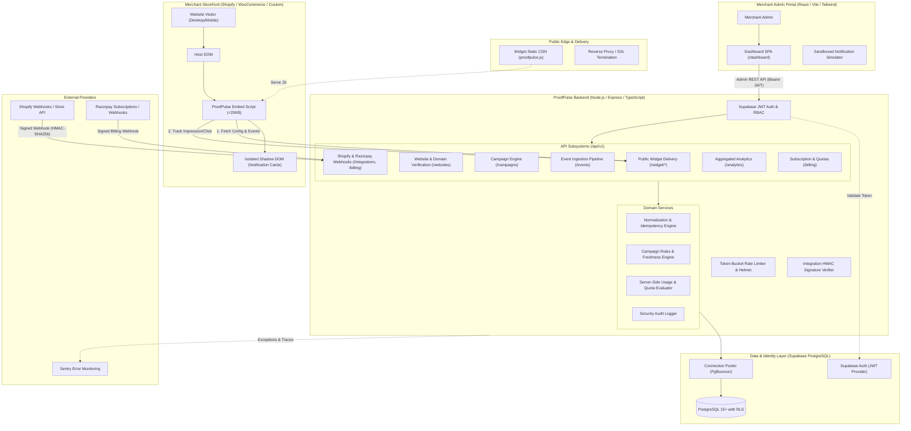
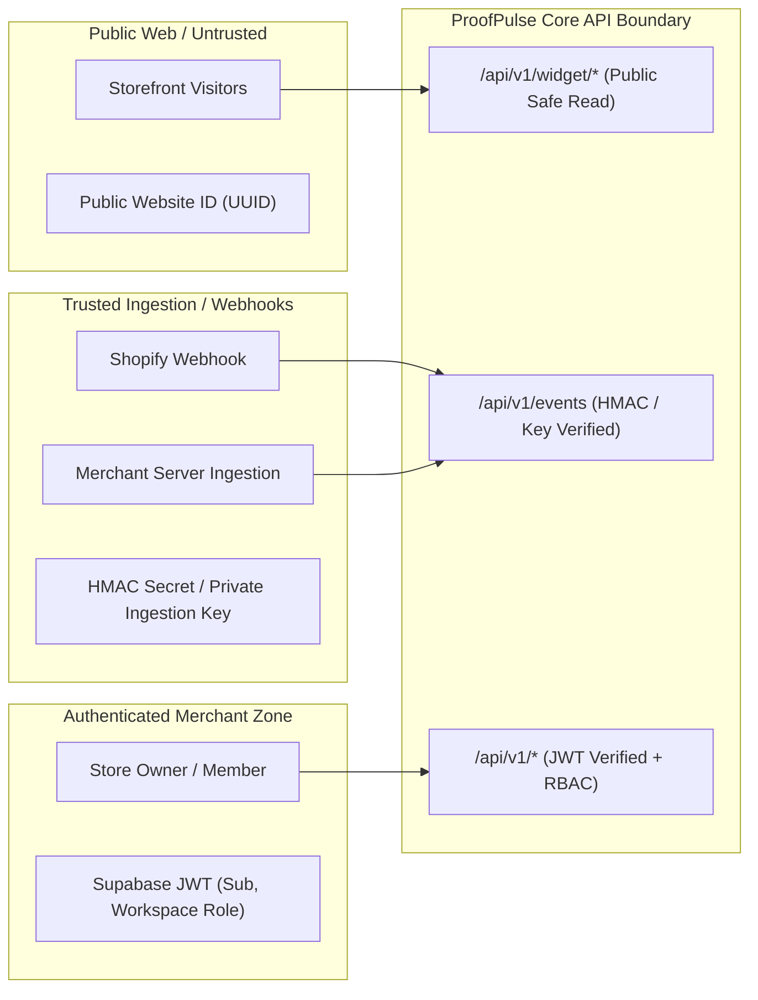

# ProofPulse System Architecture & Technical Overview

## 1. Executive Summary

**ProofPulse** is an enterprise-grade, real-time social proof and ethical urgency SaaS platform engineered primarily for small and medium-sized e-commerce merchants in India (Shopify, WooCommerce, course creators, D2C brands), with an architectural foundation designed for global scale.

### Core Philosophy: Absolute Truth in Social Proof
Unlike legacy social proof widgets that encourage deceptive timers, fake purchase popups, or inflated visitor counts, ProofPulse enforces strict **cryptographic verification and authoritative event provenance**:
- Every purchase popup maps to a verified webhook or server-authenticated event.
- Live visitor counts rely on active, time-windowed presence telemetry (no synthetic multipliers).
- Low-stock urgency requires authoritative inventory snapshots from merchant store systems.
- Offer countdowns enforce immutable deadlines stored on the server.
- If data is stale, missing, or unverified, the widget suppresses the notification entirely.

---

## 2. High-Level Architecture Diagram



---

## 3. Subsystem Breakdown

### 3.1. Standalone Embeddable Widget (`apps/widget`)
- **Runtime Footprint**: Zero external dependencies (no React, no jQuery, no CSS libraries). Target bundle size: `< 20 KB` gzipped.
- **Style Encapsulation**: Employs the **W3C Shadow DOM API** (`mode: 'closed'`) so the host website's stylesheets cannot distort widget presentation, and widget CSS never leaks into the merchant's storefront.
- **Asynchronous Execution**: Bootstraps asynchronously via `<script async src=".../proofpulse.js" data-website-id="SITE_ID">` without blocking the Critical Rendering Path (CRP) or impacting Core Web Vitals (LCP, CLS, FID/INP).
- **Graceful Fault Tolerance**: Operates under a strict `try/catch` isolation policy. If the API returns a `5xx`, drops a packet, or experiences network disruption, the widget fails silently with zero console spam and zero impact on the host store.
- **Accessibility (a11y)**: Compliant with WCAG 2.1 AA. Employs `role="status"`, `aria-live="polite"`, high-contrast color ratios, and keyboard-accessible dismissal (`Escape`, `Tab`, `Enter`).

### 3.2. RESTful API Server (`apps/api`)
- **Framework**: Node.js 22 LTS with Express and strict TypeScript.
- **Versioning**: All routes strictly namespaced under `/api/v1`.
- **Validation**: 100% of request bodies, query params, and headers validated with **Zod** schemas before reaching controller logic. Invalid payloads immediately return structured `400 Bad Request` with exact parameter issues.
- **Security & Hardening**:
  - `helmet` for secure HTTP response headers (CSP, HSTS, X-Content-Type-Options).
  - Centralized error-handling middleware preventing stack trace leakage in production.
  - Request correlation IDs (`X-Correlation-ID`) attached to every request and structured Pino log entry.
  - Two-tier rate limiting: IP/Token bucket for public widget queries; workspace-keyed rate limiting for authenticated dashboard calls.
- **API Documentation**: OpenAPI 3.0 specification auto-rendered via Swagger UI at `/api-docs` (environment restricted).

### 3.3. Merchant Dashboard SPA (`apps/dashboard`)
- **Technology**: React 18/19, TypeScript (strict), Vite, Tailwind CSS, React Router v6.
- **Design System**: High-clarity, high-contrast B2B SaaS design system with dark/light visual tokens, accessible forms, responsive sidebars, skeleton loaders, and zero non-functional controls.
- **State & Data Layer**: Centralized API client with automatic JWT token refresh, optimistic UI patterns, and typed error state handling.
- **Interactive Preview Canvas**: Live sandbox component allowing merchants to preview position (Bottom Left, Bottom Right, Top Left, Top Right), animations (Slide, Fade, Bounce), timing, and themes in real time without triggering production impressions.

### 3.4. Event Ingestion Pipeline (`apps/api/src/modules/events`)
- **Event Types Supported**:
  1. `purchase` (Customer order created/paid)
  2. `signup` (New user registered)
  3. `registration` (Webinar, course, or waitlist entry)
  4. `inventory_update` (Authoritative stock level change)
- **Ingestion Pipeline Flow**:
  1. **Authentication**: Private API key (`Authorization: Bearer pp_live_...`) or HMAC signature header (`X-Shopify-Hmac-Sha256`).
  2. **Schema Validation**: Strict Zod parse on incoming payload.
  3. **Idempotency**: Lookup by `(website_id, source, source_event_id)` preventing duplicate processing on webhook retries.
  4. **Data Normalization & Anonymization**: First names and city preserved; sensitive personal data (full name, phone, street address, payment details) permanently discarded before database persistence.
  5. **Eligibility Windowing**: Events older than the campaign's `event_freshness_hours` (e.g., 48 hours) are archived and excluded from the public active queue.

---

## 4. Multi-Tenant Security & Trust Architecture



### 4.1. Trust Isolation Rules
1. **Public Website ID (`public_key` / `website_id`)**: Can ONLY read public campaign configuration and anonymized, eligible notification items. It possesses ZERO write permission for purchase events.
2. **Private Ingestion Key (`api_key` / `webhook_secret`)**: Stored as a salted Argon2/SHA-256 hash in the database. Handed exclusively to the merchant for server-to-server webhook validation.
3. **IDOR & Multi-Tenancy Enforcement**: All database queries involving workspace assets (`websites`, `campaigns`, `events`, `subscriptions`) must explicitly join against `workspace_members` checking `auth.uid() = user_id`. No entity is accessed solely by its primary UUID without validating workspace tenancy.

---

## 5. Privacy & Indian DPDP Act Readiness
ProofPulse is architected to adhere strictly to the **Digital Personal Data Protection (DPDP) Act of India** and global privacy standards:
1. **Data Minimization**: ProofPulse never stores credit card details, full customer names, complete physical street addresses, or phone numbers.
2. **Pseudonymization**: A customer named "Aarav Sharma" from Mumbai purchasing a product is persisted and served as `"Aarav from Mumbai"`.
3. **Right to Erasure**: Workspaces and websites support cascading soft-delete and hard-purge workflows that purge all historical logs and associated events.
4. **Data Sovereign Retention**: Default 30-day retention window on granular event deliveries; rolling aggregates preserved for merchant reporting.

---

## 6. Monorepo Structure

```
proofpulse/
  ├── apps/
  │   ├── api/                 # Express REST API (/api/v1) & Swagger UI
  │   ├── dashboard/           # React + Vite + Tailwind CSS Merchant Dashboard
  │   └── widget/              # Standalone TypeScript bundle (<20KB Shadow DOM)
  ├── packages/
  │   ├── shared-types/        # Canonical TypeScript types & interfaces
  │   ├── validation/          # Zod schemas shared between frontend & backend
  │   └── config/              # Shared constants, plans, and defaults
  ├── database/
  │   ├── migrations/          # Pure SQL schema migrations (001_initial_schema.sql...)
  │   └── seeds/               # Local test fixtures and deterministic seeds
  ├── tests/
  │   ├── integration/         # Supertest API endpoint test suites
  │   ├── e2e/                 # Playwright end-to-end user journey tests
  │   ├── security/            # IDOR, HMAC spoofing, and sanitization tests
  │   └── load/                # Performance benchmarks & stress test scenarios
  ├── docs/
  │   ├── architecture/        # Overview, database models, security designs
  │   ├── api/                 # OpenAPI 3.0 specification
  │   ├── development/         # Roadmap, local setup, guidelines
  │   └── operations/          # Deployment, backup, rollback procedures
  ├── .github/
  │   └── workflows/ci.yml     # Monorepo CI: lint, type-check, test, build
  ├── .env.example
  ├── .gitignore
  ├── package.json
  ├── tsconfig.base.json
  └── README.md
```
